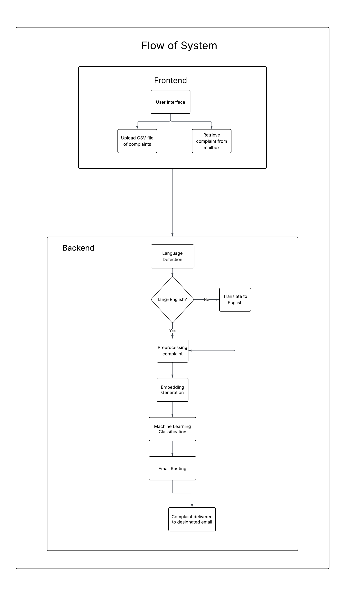
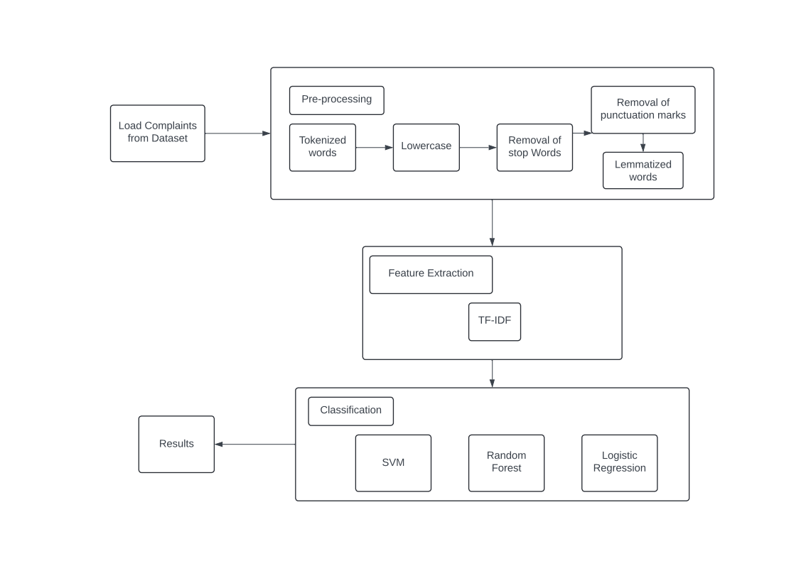
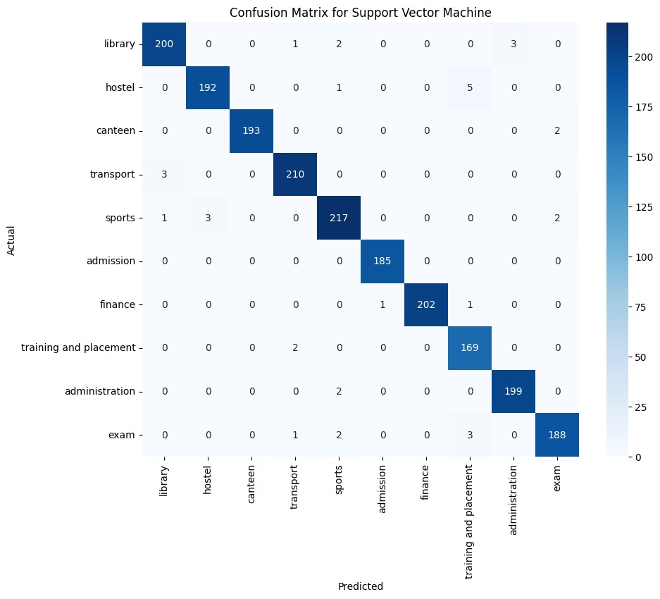
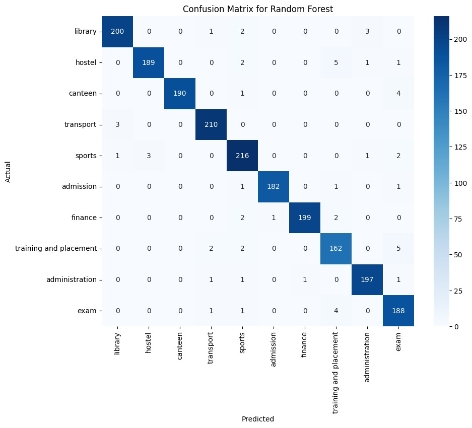
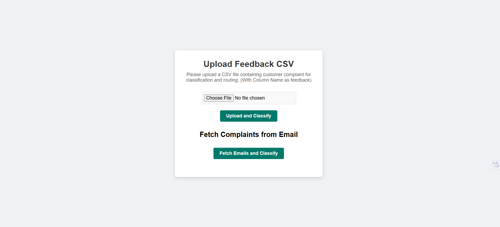

# 📬 Automated Routing and Classification of Customer Complaints (Multilingual)

> An NLP + Machine Learning system that reads complaints (from a CSV upload or directly from a mailbox), translates Hindi / Marathi / Telugu text into English, classifies each complaint into the responsible department, and routes it to that department by email, with no manual sorting.


-brightgreen)

## 🎯 Problem Statement

Educational institutions receive a large volume of student complaints and feedback, mostly by email. Handling them manually is slow, error-prone and often leads to **delayed responses and misrouted complaints**. Most existing grievance systems also:

- only understand **English**, which excludes students who write in regional languages,
- stop at **classification** and never perform the actual **routing** to a department,
- are trained on generic feedback data rather than **academic-institution-specific** complaints.

**This project closes those gaps** by combining multilingual translation, ML-based classification and automated email routing in one end-to-end pipeline.

## ✨ Key Features

- 🌐 **Multilingual input** – Hindi, Marathi and Telugu complaints are auto-detected and translated to English; English text skips translation.
- 🧠 **ML classification** – compares Logistic Regression, SVM and Random Forest on TF-IDF features; SVM is the best performer (~98% accuracy).
- 📧 **Automated email routing** – classified complaints are forwarded to the responsible department via SMTP.
- 📥 **Two input modes** – upload a CSV of complaints *or* fetch complaints directly from a mailbox (IMAP).
- 🎯 **Focused scope** – deliberately excludes sentiment analysis to keep the system lightweight and purpose-built for routing.

## 🏗️ System Architecture



**Flow:** UI → (CSV upload / mailbox fetch) → language detection → translate to English if needed → preprocessing → embedding / feature generation → ML classification → email routing → complaint delivered to the designated department email.

## 🗂️ Dataset

| Property | Detail |
|---|---|
| Size | ~9,000+ English complaints (expanded from an initial ~200) |
| Format | CSV with two columns: `feedback`, `category` |
| Categories (10) | administration, admission, canteen, exam, finance, hostel, library, sports, training and placement, transport |
| Test set | ~1,990 complaints (support per class in the reports below) |

Example row:

```
feedback: "The library's limited hours make it difficult to access resources during peak study times."
category: library
```

## 🔬 Methodology



1. **Data collection** – college-department complaints covering fees, documents, exams, hostel, library and more.
2. **Preprocessing** – lowercasing, removing punctuation/numbers/special characters, tokenization, stop-word removal, lemmatization.
3. **Feature extraction** – **TF-IDF** vectorization.
4. **Classification** – Logistic Regression, SVM and Random Forest, with hyperparameters tuned via **grid search**.
5. **Evaluation** – accuracy, precision, recall, F1-score and confusion matrices.
6. **Language handling** – language detection + translation for Hindi / Marathi / Telugu before classification.
7. **Routing** – predicted category is mapped to the department's email address and the complaint is forwarded over SMTP.

## 📊 Results

### Model comparison

| Model | Accuracy* | Notes |
|---|---|---|
| **Support Vector Machine** | **≈ 98%** | Best overall; F1 ≥ 0.97 in every category |
| Logistic Regression | ≈ 97–98% | Very close; strong on exam, canteen, placement |
| Random Forest | ≈ 97% | Slightly lower on sports and transport |

\*Overall accuracy computed from the confusion-matrix diagonals on the ~1,990-sample test set: SVM 98.2%, Logistic Regression 97.5%, Random Forest 97.1%.

### Per-category F1-score

| Category | Random Forest | Logistic Regression | **SVM** |
|---|:-:|:-:|:-:|
| administration | 0.98 | 0.96 | **0.98** |
| admission | 0.97 | 0.97 | **0.98** |
| canteen | 0.99 | 0.99 | **0.99** |
| exam | 0.98 | 0.99 | **0.98** |
| finance | 0.96 | 0.95 | **0.97** |
| hostel | 0.99 | 0.99 | **1.00** |
| library | 0.99 | 0.99 | **1.00** |
| sports | 0.94 | 0.96 | **0.97** |
| training and placement | 0.98 | 0.99 | **0.99** |
| transport | 0.95 | 0.96 | **0.97** |

<details>
<summary><b>Full classification reports (precision / recall / F1 / support)</b></summary>

#### Support Vector Machine

| Category | Precision | Recall | F1 | Support |
|---|:-:|:-:|:-:|:-:|
| administration | 0.98 | 0.97 | 0.98 | 206 |
| admission | 0.98 | 0.97 | 0.98 | 198 |
| canteen | 1.00 | 0.99 | 0.99 | 195 |
| exam | 0.98 | 0.99 | 0.98 | 213 |
| finance | 0.97 | 0.97 | 0.97 | 223 |
| hostel | 0.99 | 1.00 | 1.00 | 185 |
| library | 1.00 | 0.99 | 1.00 | 204 |
| sports | 0.95 | 0.99 | 0.97 | 171 |
| training and placement | 0.99 | 0.99 | 0.99 | 201 |
| transport | 0.98 | 0.97 | 0.97 | 194 |

#### Logistic Regression

| Category | Precision | Recall | F1 | Support |
|---|:-:|:-:|:-:|:-:|
| administration | 0.98 | 0.95 | 0.96 | 206 |
| admission | 0.98 | 0.95 | 0.97 | 198 |
| canteen | 1.00 | 0.98 | 0.99 | 195 |
| exam | 0.99 | 0.99 | 0.99 | 213 |
| finance | 0.94 | 0.97 | 0.95 | 223 |
| hostel | 0.99 | 0.99 | 0.99 | 185 |
| library | 1.00 | 0.98 | 0.99 | 204 |
| sports | 0.94 | 0.98 | 0.96 | 171 |
| training and placement | 0.98 | 1.00 | 0.99 | 201 |
| transport | 0.96 | 0.97 | 0.96 | 194 |

#### Random Forest

| Category | Precision | Recall | F1 | Support |
|---|:-:|:-:|:-:|:-:|
| administration | 0.98 | 0.97 | 0.98 | 206 |
| admission | 0.98 | 0.95 | 0.97 | 198 |
| canteen | 1.00 | 0.97 | 0.99 | 195 |
| exam | 0.98 | 0.99 | 0.98 | 213 |
| finance | 0.95 | 0.97 | 0.96 | 223 |
| hostel | 0.99 | 0.98 | 0.99 | 185 |
| library | 0.99 | 0.98 | 0.99 | 204 |
| sports | 0.93 | 0.95 | 0.94 | 171 |
| training and placement | 0.98 | 0.98 | 0.98 | 201 |
| transport | 0.93 | 0.97 | 0.95 | 194 |

</details>

### Confusion matrices

**Support Vector Machine (best model)**



**Logistic Regression**


**Random Forest**



### Key insights

- **SVM generalizes best**, reaching near-perfect scores for hostel, library, canteen and placement complaints.
- **Sports** has the lowest precision (0.93–0.95) across models: high recall but occasional over-prediction.
- **Error analysis:** most misclassifications come from overlapping vocabulary — e.g. *"room"*, *"facility"*, *"staff"* shared by Hostel and Administration, and *"service"*, *"quality"* shared by Canteen and Transport. Classical TF-IDF models can't fully resolve this context, motivating contextual embeddings (BERT) as future work.

## 🖥️ User Interface



A simple web interface with two entry points:
- **Upload Feedback CSV** – upload a file with a `feedback` column and click *Upload and Classify*.
- **Fetch Complaints from Email** – pull complaints from the configured mailbox and classify/route them.

## 🧰 Tech Stack

| Module | Technology |
|---|---|
| Language | Python |
| ML | scikit-learn (SVM, Logistic Regression, Random Forest), TF-IDF |
| NLP preprocessing | NLTK / spaCy |
| Language detection & translation | langdetect, Google Translate / Indic NLP tooling |
| Email retrieval | IMAP (`imaplib`) |
| Email routing | SMTP (Gmail SMTP for testing) |
| Data | CSV (`feedback`, `category`) |
| Development | Jupyter Notebook / Google Colab |

## 🚀 Getting Started

```bash
# 1. Clone the repository
git clone https://github.com/abhijeetsahu09/Customer_Complaint_Classification_and_routing.git
cd Customer_Complaint_Classification_and_routing

# 2. Create a virtual environment and install dependencies
python -m venv venv
source venv/bin/activate        # Windows: venv\Scripts\activate
pip install -r requirements.txt

# 3. Configure email credentials (use an app password, never your real password)
cp .env.example .env            # then edit IMAP / SMTP settings

# 4. Run the application
python app.py
```

## ⚠️ Limitations & Future Work

- **Contextual understanding** – integrate **BERT / Transformer** embeddings to resolve keyword-overlap errors.
- **Class imbalance** – apply SMOTE or class-weighted loss for under-represented categories.
- **Real-time processing** – move from batch processing to cloud-deployed, real-time classification.
- **Richer preprocessing** – add NER and POS tagging; use domain lexicons / knowledge graphs.
- **Multimodal complaints** – support voice notes (speech-to-text) and images.
- **Continuous learning** – active learning from user feedback and new complaint categories.
- **Beyond academia** – extend to corporate customer support and government grievance portals.
